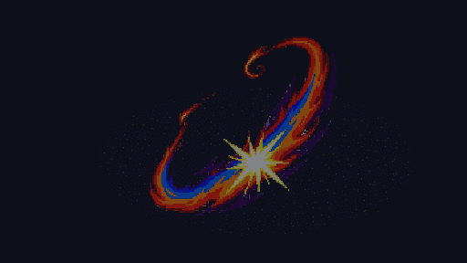

# Bitter Blade — Malvalame / Ceruledge

Concept VFX pixel-art généré pour la capacité signature de Malvalame : arc rouge-orange, cœur bleu, impact blanc, puis retour d’énergie rouge-or pour évoquer la récupération des PV.

La donnée PMDO 0.8.12 adaptée est `source/bitter_blade_v1/Data/Skill/bitter_blade.json`. Elle utilise les animations natives `Slash_RSE` et `Absorb`; le GIF et le PNG généré ne constituent pas un `.dir` importable dans le moteur. L’intégration et le rendu en jeu restent à valider avec PMDO.
