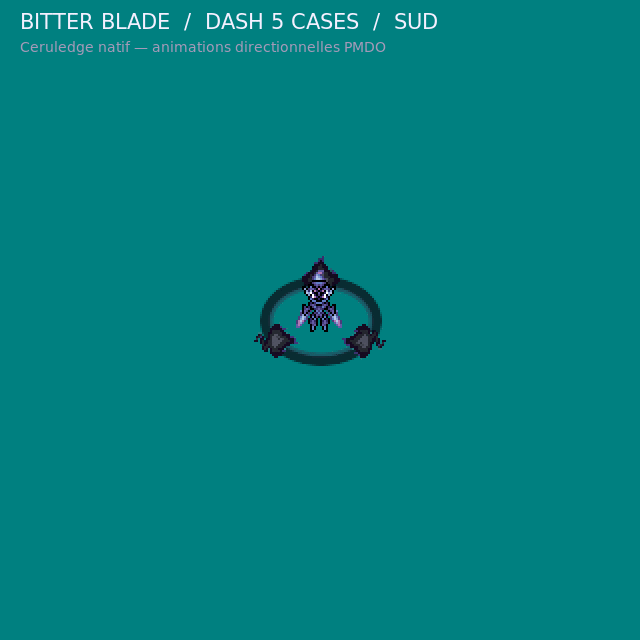

# Bitter Blade — Malvalame / Ceruledge

L’aperçu enchaîne les huit directions de `Walk-Anim.png` de Ceruledge #0937 : les poses natives ne sont pas tournées. Il montre le dash de cinq cases, la traînée de feux follets, l’aura et l’impact. Les véritables ressources d’animation PMDO sont les trois `.dir` et la donnée de capacité sous `source/bitter_blade_v1/`; le GIF n’est qu’un aperçu de contrôle, pas un rendu du moteur.

Sprite d’aperçu : **BaronessFaron / PMDCollab_1**, PMD Sprite Collab #0937, [**CC BY-NC 4.0**](https://creativecommons.org/licenses/by-nc/4.0/) — [source](https://sprites.pmdcollab.org/#/0937?form=0). Les frames du GIF sont recadrées, agrandies et composées avec les VFX; les poses sources ne sont pas retouchées ni pivotées. Le crédit d’origine et le manifeste épinglé sont conservés dans `source/bitter_blade_v1/references/upstream/ceruledge_sprite/`.
