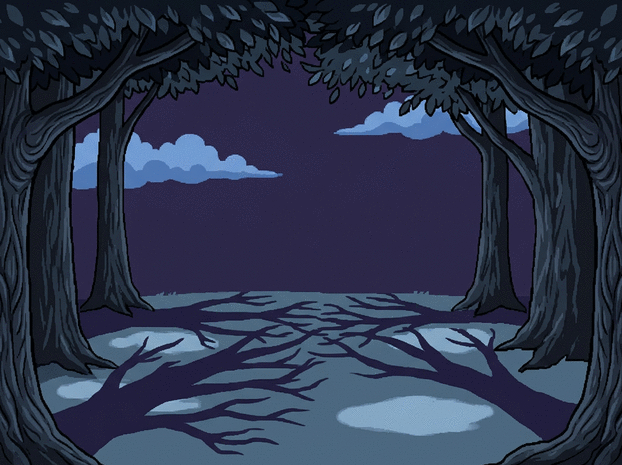

# Darkrai — sortie de l’ombre à la lisière d’une forêt

La scène commence dans une clairière nocturne où les ombres des arbres marquent le sol. Darkrai apparaît d’abord comme une silhouette fixe, puis sa version couleur complète se révèle en une seule étape — le rouge du col et toutes les autres couleurs arrivent ensemble. Il se dissout ensuite en fragments et particules sombres qui s’élèvent avant de disparaître.

La pose, l’échelle et le cadrage de Darkrai restent fixes; la séquence n’ajoute ni éclair ni changement de sprite.
