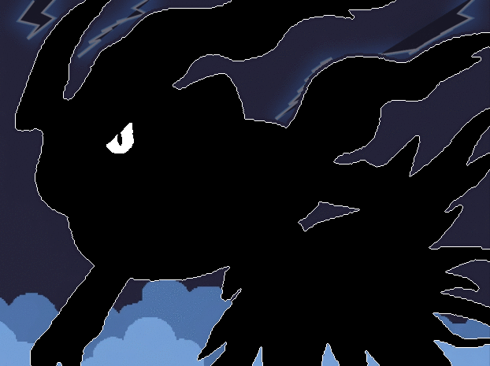

# Darkrai — séquence sprite (yeux bleus)

La séquence garde exactement la même forme, pose, échelle, placement et cadrage de Darkrai; seules les couleurs et les lumières varient. Des éclairs bleu-blanc et leurs flashs apparaissent dans le ciel, derrière le sprite. La crête est blanche neutre, sans dominante jaune; l’œil est bleu et le col rouge est conservé.

Le GIF est un aperçu d’illustration, pas une ressource sprite PMDO `.tile`.
